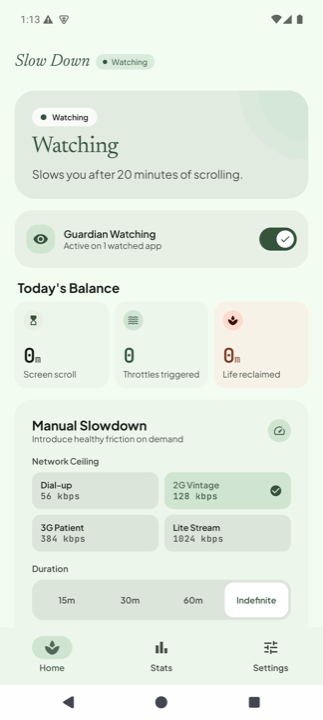
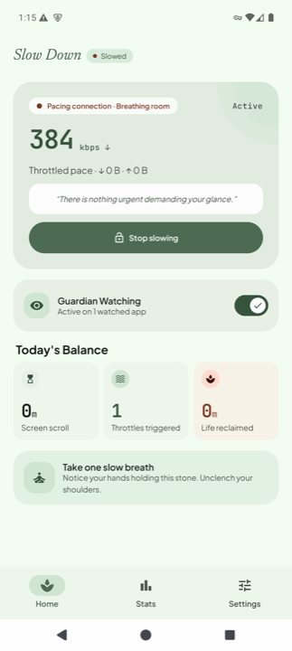
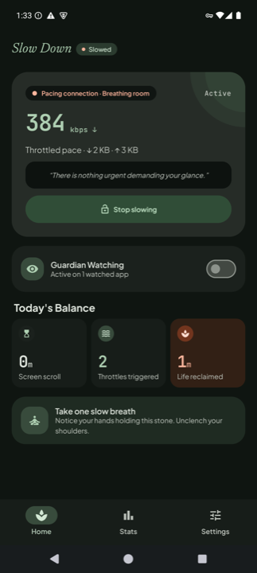
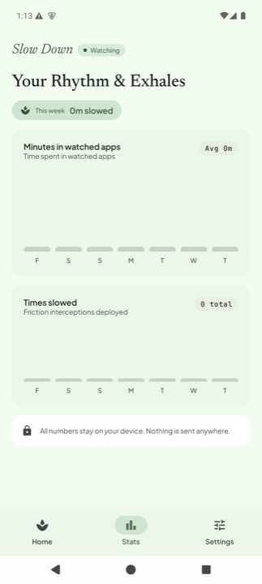
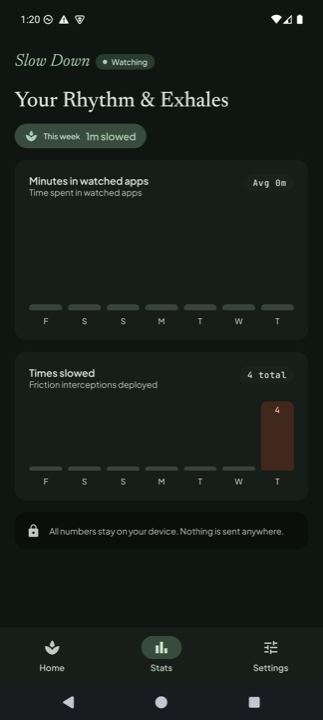
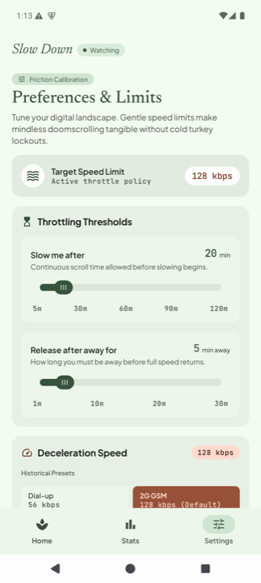

# Slow Down

**Bring dial-up back, on purpose.** Slow Down is an Android app that makes your internet slow when you doom scroll. At 2G or dial-up speed the feed stops being fun, so you look up.

Built for the [Kiroween 2026](https://kiroween.devpost.com/) hackathon, **Resurrection** category: *bring your favorite dead technology back to life*. The dead technology here is slow internet. Dial-up and 2G were a problem we fixed. Slow Down revives them as a digital wellbeing tool.

The idea came from the author's commute. A slow connection made them stop scrolling.

<p>



</p>
<p>



</p>

## How it works
1. You pick watched apps, a time limit (5 to 120 min), a speed (32 to 1024 kbps) and a release time (1 to 30 min).
2. A foreground service reads `UsageStatsManager` events every 15 s and tracks how long you stay in a watched app.
3. At the limit, a local `VpnService` slows those apps and a notification says "You have been scrolling N min. Slowing down." with a Stop button.
4. When you have been away for the release time, speed returns.

You can also tap "Slow me down now" with a 15, 30 or 60 min timer.

No root. No account. No server. Settings and stats stay on the phone (DataStore).

## How the throttle works
The VPN sends the covered apps' IPv4 traffic into a TUN interface. Our engine (`:throttle`) reads the raw packets and plays the server for the app's TCP stack. It opens its own real socket (`protect()`ed, so it skips the VPN) to the real server, and moves bytes through a token bucket.

- **Download:** the engine reads from the real socket only when the bucket has tokens and the app's window has room. TCP flow control slows the server. Nothing is dropped.
- **Upload:** app data waits in a 64 KB buffer that drains at the upload rate, and the advertised window shrinks when it is full.
- **UDP:** extra packets are dropped, so QUIC backs off. DNS is not limited.
- **IPv6:** not routed. IPv6 connects fail at once and apps fall back to IPv4.

Details: [`docs/REPORT-engine.md`](docs/REPORT-engine.md).

## Architecture
```
app/        Compose UI (Material 3 Expressive), detection, DataStore
  logic/    DoomScrollDetector (pure Kotlin), WatchEngine, ThrottleCoordinator
  watch/    WatcherService, UsageEventsReader, Notifier, receivers
throttle/   Android library, no UI: RelayEngine, TcpSession, TokenBucket, SlowDownVpnService
.kiro/      specs, steering, hooks (written after the build)
docs/       measured reports, screenshots
```
`:app` depends on `:throttle`. Only `ThrottleCoordinator` calls the engine.

## Measured speed
Emulator, Android 15 (API 35). 12 s HTTPS download per run. Source: [`docs/REPORT-e2e.md`](docs/REPORT-e2e.md).

| Limit (kbps) | Measured (kbps) | Error |
|---|---|---|
| none (baseline) | 29833 | |
| 128 | 127.0 | -0.8% |
| 384 | 387.4 and 388.1 | +0.9% / +1.1% |
| 1024 | 1012.7 | -1.1% |

A real doom-scroll run with YouTube (threshold 5 min, release 1 min): the throttle started by itself after about 5 min, covered only YouTube's uid, and ended 1 to 2 min after leaving the app. 42 JVM tests pass (22 engine, 20 app).

## Build and run
Needs JDK 17+ and the Android SDK (compileSdk 36). Set `sdk.dir` in `local.properties` (Android Studio does this).

```
./gradlew assembleDebug
./gradlew :app:installDebug          # device or emulator connected
./gradlew testDebugUnitTest          # 42 tests
```

On first run the onboarding asks for three permissions:
1. **VPN consent** (the system dialog).
2. **Notifications** (Android 13+).
3. **Usage access** (Settings page). Without it only manual slow-down works.

## Limitations
- Tested on one emulator (API 35). Not tested on a physical phone.
- IPv6 is blocked for covered apps, so an IPv6-only network will not work.
- No DNS servers are set on the VPN. Private DNS with a hostname is untested.
- Changing "What to slow" in Settings does not affect a throttle already running.
- Only one TCP stream was measured. QUIC, parallel streams and extra latency were not tested.
- YouTube's own speed under the limit was not measured. Per-app proof is the VPN uid list.
- The release build is unsigned and not minified. Play Store needs a "special use" foreground service declaration.

## Built with Kiro
Built with Kiro Crew in conductor mode: one goal, work items, a worker session per item, and independent verifier workers. The UI was designed in Google Stitch and imported by hand as a zip. The specs, steering and hooks in [`.kiro/`](.kiro) were written after the build. Details: [`docs/KIRO_WRITEUP.md`](docs/KIRO_WRITEUP.md).

## License
[MIT](LICENSE)
